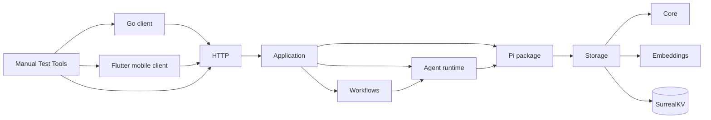

# Codemap

## Overview

Second Brain is a Bun-native TypeScript memory server. Elysia exposes intake,
recall, graph, pipeline, and dream-job HTTP routes. Application composition
connects Pi workflows, the knowledge graph, embedded SurrealDB storage, and an
OpenAI embedding adapter. Go and Flutter clients use the HTTP boundary.

### Key Flows

## TypeScript modules

### Core (`src/core/`)

Shared configuration and domain types for the TypeScript server.

**Responsibilities:** workflow model parsing, environment settings, shared graph and intake types, invalid-input errors

**Dependencies:** none

**Files:** `src/core/**`, `tests/config.test.ts`

### Storage (`src/storage/`)

Owns embedded SurrealKV persistence behind plain domain and transaction interfaces.

**Responsibilities:** latest schema and indexes, SDK normalization, graph records, vector and lexical search, cooccurrence resolution, atomic transactions, permanent intake idempotency keys and replay receipts, intake queue and dream operations

**Dependencies:** Core for domain types, Embeddings for vector generation

**Files:** `src/storage/**`, `tests/storage.test.ts`, `tests/surrealdb-latest.test.ts`, `tests/android-workflows.test.ts`

### Embeddings (`src/embeddings/`)

Provides validated embedding calls and an OpenAI provider adapter, independent of Pi chat model selection.

**Responsibilities:** single and batch embedding, vector validation, cancellation, OpenAI client adaptation

**Dependencies:** none

**Files:** `src/embeddings/**`, `tests/embedding.test.ts`, `tests/embedding-adapter.test.ts`

### Pi package (`packages/pi-second-brain/`)

Ships the knowledge tools as a pi package: one idiomatic extension file per tool, a typed graph library, and a storage bridge.

**Responsibilities:** TypeBox input and output schemas, graph business rules as free functions over storage, cancellation scoping, storage resolution (injected instance, injected configuration, or Pi settings with env-var and command secrets), session lifecycle cleanup, direct Pi memory entry points and shared workflow guidance in `skills/memory/ingest.md`, `recall.md`, `deduplicate.md`, and `connect.md`

**Dependencies:** Core for domain types, Storage for persistence, Embeddings for self-initialized storage

**Files:** `packages/pi-second-brain/**`, `tests/knowledge.test.ts`

### Agent runtime (`src/agent-runtime/`)

Adapts Pi AgentSession to isolated, request-scoped workflow runs.

**Responsibilities:** model selection, in-memory sessions, extension loading from the configured package path, tool activation by name, closed Codemode loadouts, custom tools such as answerRecall, event observation and structured result collection, cancellation, disposal

**Dependencies:** Core for workflow model references, the Pi package for discovered tools, Pi SDK for session execution

**Files:** `src/agent-runtime/**`, `tests/agent-runtime.test.ts`, `tests/agent-runtime/**`

### Workflows (`src/workflows/`)

Runs ingest, recall, and dream workflows, plus intake and dream background processing.

**Responsibilities:** closed workflow tool-name sets, citation collection from tool events, the answerRecall custom tool, evidence-validated recall, bounded intake staging, queue leases and retries, clean acknowledgement, dream phase ordering, idle backoff and convergence, cancellation, prompts

**Dependencies:** Agent runtime for model runs, Core for shared types

**Files:** `src/workflows/**`, `tests/workflows.test.ts`, `tests/intake-pipeline.test.ts`, `tests/intake-reliability.test.ts`, `tests/dream-scheduler.test.ts`, `tests/dream-convergence.test.ts`

### HTTP (`src/http/`)

Defines typed HTTP contracts and adapts Elysia routes to the application boundary.

**Responsibilities:** TypeBox request and response schemas, application errors, live recall citation resolution, health, ingest, pipeline controls, recall, hybrid search, batch graph refresh, dream jobs and graph lookup; conversation and MCP routes are absent

**Dependencies:** Application for route operations, Core for input errors

**Files:** `src/http/**`, `tests/http-schemas.test.ts`, `tests/http.test.ts`, `tests/recall-service.test.ts`, `tests/android-workflows.test.ts`

### Application (`src/application/`)

Composes production dependencies and owns application startup, shutdown, and HTTP-facing services.

**Responsibilities:** shared runtime composition, storage injection into the Pi package bridge, loading bundled guidance for separate ingest, recall, and dream prompts, startup ordering, partial-start cleanup, worker shutdown, storage closure, intake and recall services, graph wire projections, hybrid search and ordered batch graph refresh, in-memory dream-job lifecycle, Bun entry point

**Dependencies:** Core, Embeddings, Storage, Pi package bridge, Agent runtime, Workflows, HTTP contracts

**Files:** `src/application/**`, `src/main.ts`, `tests/application.test.ts`, `tests/android-workflows.test.ts`

## Clients

### Go client (`client/`)

Cobra commands use the non-conversation HTTP API for ingest, recall, and graph
lookup. The Bubble Tea TUI still targets the removed conversation API and is not
supported by the Bun server.

### Flutter mobile client (`client/mobile/`)

Provides offline-first Capture, saved Answer snapshots, named Brain profiles, and read-only Graph exploration over the HTTP API.

**Responsibilities:** SQLite-backed profiles, Capture outbox, Answer snapshots, and per-Brain Graph workspaces; one-time migration from legacy settings; profile-scoped Access secrets; foreground sync across all Brain outboxes on app open and resume; cached-first Explore with search, graph refresh, and local workspace controls; Capture, Ask history, Outbox, Brains, and Graph screens

**Dependencies:** HTTP for server operations, Flutter storage and secure-storage plugins for local persistence

**Files:** `client/mobile/**`

## Deployment and manual tests

`Dockerfile` builds a Bun production image and copies `packages/` beside `src/`.
`docker-compose.yml` provides server, test, and isolated mobile profiles with separate
database volumes. `tools/mobile/` owns the pinned Flutter toolchain.
`.pi/settings.json` registers the package for direct Pi use in this repository. The
server registers the same package through `BRAIN_PI_TOOLS_PACKAGE` and
`DefaultResourceLoader` extension paths.

### Manual Test Tools (`tools/manual-test/`)

Provides permanent instructions and shell-driven journeys for the public HTTP API and shipped clients.

**Responsibilities:** Bun startup, intake and queue controls, recall, graph lookup, dream jobs, restart and shutdown journeys

**Dependencies:** HTTP, Go client, Flutter mobile client

**Files:** `tools/manual-test/**`, `docs/manual-tests/typescript-server.md`
