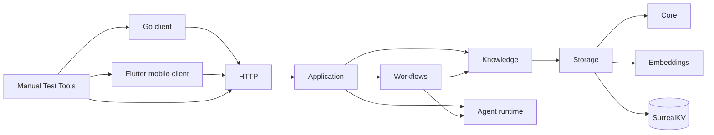
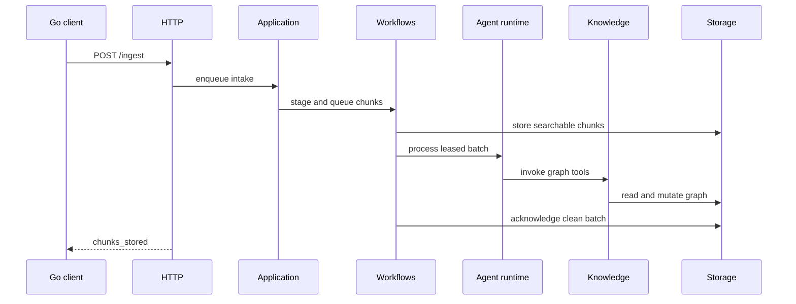
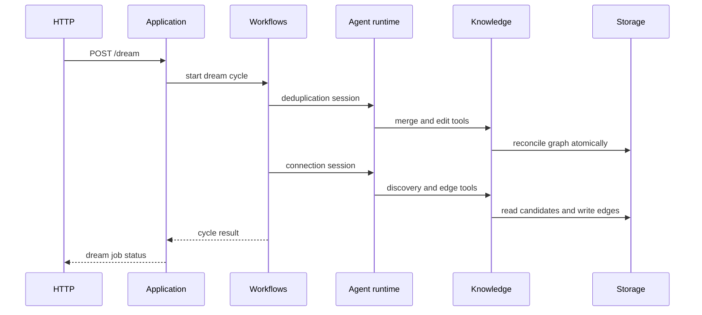

# Codemap

## Overview

Second Brain is a Bun-native TypeScript memory server. Elysia exposes intake,
recall, graph, pipeline, and dream-job HTTP routes. Application composition
connects Pi workflows, the knowledge graph, embedded SurrealDB storage, and an
OpenAI embedding adapter. Go and Flutter clients use the HTTP boundary.

### Key Flows

## TypeScript modules

### Core (`src/core/`)

Shared configuration and domain types for the TypeScript server.

**Responsibilities:** workflow model parsing, environment settings, shared graph and intake types, invalid-input errors

**Dependencies:** none

**Files:** `src/core/**`, `tests/config.test.ts`

### Storage (`src/storage/`)

Owns embedded SurrealKV persistence behind plain domain and transaction interfaces.

**Responsibilities:** latest schema and indexes, SDK normalization, graph records, vector and lexical search, cooccurrence resolution, atomic transactions, intake queue and dream operations

**Dependencies:** Core for domain types, Embeddings for vector generation

**Files:** `src/storage/**`, `tests/storage.test.ts`, `tests/surrealdb-latest.test.ts`

### Embeddings (`src/embeddings/`)

Provides validated embedding calls and an OpenAI provider adapter, independent of Pi chat model selection.

**Responsibilities:** single and batch embedding, vector validation, cancellation, OpenAI client adaptation

**Dependencies:** none

**Files:** `src/embeddings/**`, `tests/embedding.test.ts`, `tests/embedding-adapter.test.ts`

### Knowledge (`src/knowledge/`)

Owns graph business rules and model-facing domain tools over storage.

**Responsibilities:** canonical-ID validation, argument normalization, bounded graph projections, singular writes, exact edits, traversal, search, discovery, merges, edge removal and edge-type renames, TypeBox tool contracts

**Dependencies:** Core for domain types, Storage for graph operations

**Files:** `src/knowledge/**`, `tests/knowledge.test.ts`

### Agent runtime (`src/agent-runtime/`)

Adapts Pi AgentSession to isolated, request-scoped workflow runs.

**Responsibilities:** model selection, in-memory sessions, closed direct-tool and Codemode loadouts, event observation, cancellation, structured results, disposal

**Dependencies:** Core for workflow model references, Pi SDK for session execution

**Files:** `src/agent-runtime/**`, `tests/agent-runtime.test.ts`, `tests/agent-runtime/**`

### Workflows (`src/workflows/`)

Runs ingest, recall, and dream workflows, plus intake and dream background processing.

**Responsibilities:** closed workflow tool sets, evidence-validated recall, bounded intake staging, queue leases and retries, clean acknowledgement, dream phase ordering, idle backoff and convergence, cancellation, prompts

**Dependencies:** Agent runtime for model runs, Knowledge for domain tools, Core for shared types

**Files:** `src/workflows/**`, `tests/workflows.test.ts`, `tests/intake-pipeline.test.ts`, `tests/intake-reliability.test.ts`, `tests/dream-scheduler.test.ts`, `tests/dream-convergence.test.ts`

### HTTP (`src/http/`)

Defines typed HTTP contracts and adapts Elysia routes to the application boundary.

**Responsibilities:** TypeBox request and response schemas, application errors, live recall citation resolution, health, ingest, pipeline controls, recall, dream jobs and graph lookup; conversation and MCP routes are absent

**Dependencies:** Application for route operations, Core for input errors

**Files:** `src/http/**`, `tests/http-schemas.test.ts`, `tests/http.test.ts`, `tests/recall-service.test.ts`

### Application (`src/application/`)

Composes production dependencies and owns application startup, shutdown, and HTTP-facing services.

**Responsibilities:** shared runtime composition, startup ordering, partial-start cleanup, worker shutdown, storage closure, intake and recall services, graph wire projections, in-memory dream-job lifecycle, Bun entry point

**Dependencies:** Core, Embeddings, Storage, Knowledge, Agent runtime, Workflows, HTTP contracts

**Files:** `src/application/**`, `src/main.ts`, `tests/application.test.ts`

## Clients

### Go client (`client/`)

Cobra commands and Bubble Tea TUI use the non-conversation HTTP API for ingest,
recall, and graph lookup. The client is unchanged by the server rewrite.

### Flutter mobile client (`client/mobile/`)

Capture and one-shot Ask use the same HTTP API. Settings and failed Capture
drafts remain local. The client is unchanged by the server rewrite.

## Deployment and manual tests

`Dockerfile` builds a Bun production image. `docker-compose.yml` provides server,
test, and isolated mobile profiles with separate database volumes. `tools/mobile/`
owns the pinned Flutter toolchain.

### Manual Test Tools (`tools/manual-test/`)

Provides permanent instructions and shell-driven journeys for the public HTTP API and shipped clients.

**Responsibilities:** Bun startup, intake and queue controls, recall, graph lookup, dream jobs, restart and shutdown journeys

**Dependencies:** HTTP, Go client, Flutter mobile client

**Files:** `tools/manual-test/**`, `docs/manual-tests/typescript-server-rewrite.md`, `docs/manual-tests/typescript-server.md`
