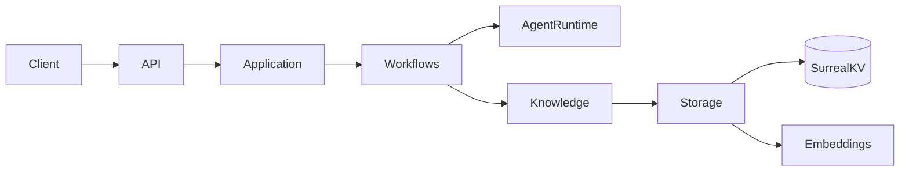

# Codemap

## Overview

Second Brain is a Bun-native TypeScript memory server. Elysia exposes intake,
recall, graph, pipeline, and dream-job HTTP routes. Application composition
connects Pi workflows, the knowledge graph, embedded SurrealDB storage, and an
OpenAI embedding adapter. Go and Flutter clients use the HTTP boundary.

## TypeScript modules

### Core (`src/core/`)

Shared configuration and domain types. Configuration parses required
`provider/model:effort` references for ingest, recall, and dream workflows and
loads intake, dream, embedding, and database limits.

### Storage (`src/storage/`)

`embedded.ts` owns the SurrealKV connection, latest schema and indexes, SDK
normalization, graph records, vector and lexical search, cooccurrence
resolution, atomic transactions, and the intake queue. `storage.ts` exposes the
plain domain boundary and transaction scope. `schema.ts` contains only
TypeScript-owned SurrealDB definitions.

### Embeddings (`src/embeddings/`)

`embedder.ts` validates configured provider vectors and cancellation. `openai.ts`
adapts the official OpenAI TypeScript client. Embeddings remain independent of
Pi chat model selection.

### Knowledge (`src/knowledge/`)

`index.ts` is the deep graph domain module. It validates canonical IDs,
normalizes model arguments, projects bounded public records, handles singular
node and edge writes, exact node edits, graph traversal, search, discovery,
node and edge merges, edge removal, and global edge-type renames. `schemas.ts`
contains TypeBox input and output contracts for direct Pi and Codemode tools.

### Agent runtime (`src/agent-runtime/`)

`index.ts` adapts the Pi `AgentSession` SDK. Each request gets an in-memory
session, explicit domain tools, Codemode with model access disabled, no built-in
filesystem/shell/network/MCP tools, event observation, cancellation, and
unconditional disposal. The injected `SessionFactory` is the deterministic test
seam.

### Workflows (`src/workflows/`)

`workflows.ts` defines ingest, recall, and dream workflows with closed tool
loadouts. Recall collects live-session evidence and accepts only validated
`answerRecall` citations. `intake-pipeline.ts` stages bounded text, leases
contiguous queue batches, renews ownership, retries failures, and acknowledges
only clean runs. `dream-scheduler.ts` performs deduplication before connection,
tracks idle backoff and convergence, and cancels on activity. `prompts.ts` holds
workflow prompts.

### HTTP (`src/http/`)

`schemas.ts` defines TypeBox request, response, header, and path boundaries.
`contracts.ts` owns application errors and live recall citation resolution.
`server.ts` is the Elysia adapter. It mounts health, ingest, pipeline controls,
recall, dream jobs, and graph lookup. Conversation and MCP routes are absent.

### Application (`src/application/`)

`runtime.ts` owns startup ordering, partial-start cleanup, worker shutdown, and
storage closure. `composition.ts` creates one model runtime, embedder, storage,
knowledge graph, pipeline, scheduler, recall service, graph wire projections,
and in-memory dream-job registry. `src/main.ts` loads environment settings,
creates standard Pi/OpenAI transports, starts the application, and listens on
port 8000.

## Clients

### Go client (`client/`)

Cobra commands and Bubble Tea TUI use the non-conversation HTTP API for ingest,
recall, and graph lookup. The client is unchanged by the server rewrite.

### Flutter mobile client (`client/mobile/`)

Capture and one-shot Ask use the same HTTP API. Settings and failed Capture
drafts remain local. The client is unchanged by the server rewrite.

## Deployment and manual tests

`Dockerfile` builds a Bun production image and excludes the legacy Python source
from the image. `docker-compose.yml` provides server, test, and isolated mobile
profiles with separate database volumes. `tools/mobile/` owns the pinned
Flutter toolchain. `tools/manual-test/` documents Bun HTTP, CLI, restart, and
shutdown journeys. `docs/manual-tests/typescript-server.md` records the
automated gate and pending live checks.

## Legacy source

`src/second_brain/` remains in the repository as a rollback reference. Production
TypeScript startup does not import it, and the Docker image excludes it.
