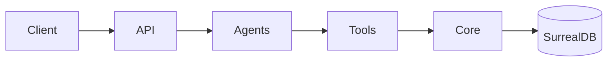
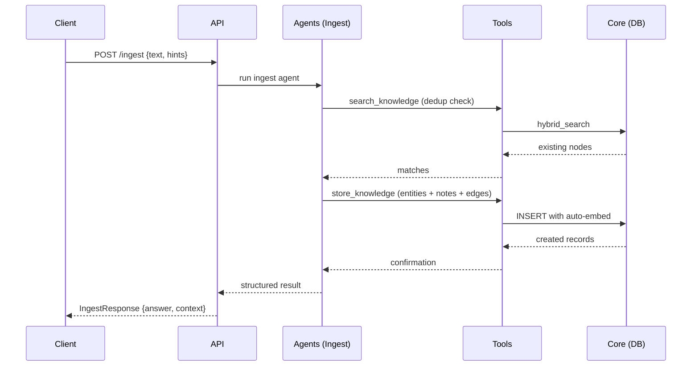
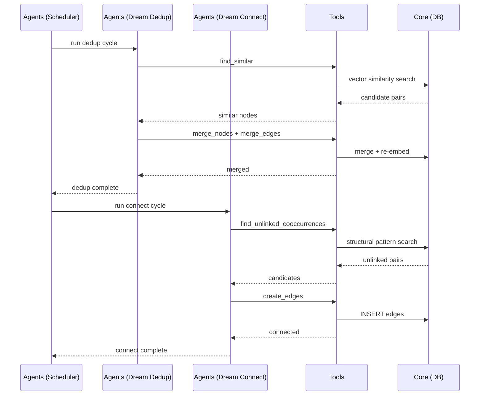

# Codemap

## Overview

Personal knowledge engine: a FastAPI REST API backed by an embedded SurrealDB graph database with five PydanticAI agent loops (ingest, recall, converse, dream-dedup, dream-connect), plus a Go terminal client (Cobra CLI + Bubble Tea TUI). Knowledge flows in via ingest, is retrieved via recall, and is autonomously refined by background "dreaming" agents that deduplicate and discover missing connections.

### Key Flows

**Ingest → Knowledge Graph**

**Dream Cycle (Background)**

## Modules

### Core

Foundation layer: configuration, shared types, database schema, model/embedding factory, and input validation.

**Responsibilities:** environment-based settings (`BRAIN_` prefix), SurrealDB schema definition (tables, BM25 analyzers, HNSW vector indexes), Pydantic models and serialization helpers for SurrealDB types (RecordID, datetime), model/embedding provider factory (direct API keys, Azure Foundry with AAD/key auth), record ID and identifier validation

**Dependencies:** none (leaf module — everything else depends on this)

**Files:**
- `src/second_brain/config.py`
- `src/second_brain/models.py`
- `src/second_brain/validation.py`
- `src/second_brain/providers.py`
- `src/second_brain/db.py`
- `src/second_brain/__init__.py`
- `src/second_brain/py.typed`
- `tests/test_config.py`
- `tests/test_db.py`
- `tests/test_models.py`
- `tests/test_providers.py`
- `tests/test_embedding.py`
- `tests/test_validation.py`

### Tools

Database read/write operations consumed by agents. Three tool sets: ingest (composite `store_knowledge` for one-call creation with reference resolution, plus bulk create notes/entities/edges and update nodes), recall (hybrid BM25+vector search with RRF fusion, node lookup, edge enrichment), and dream (semantic similarity search, node/edge merging, graph traversal, co-occurrence discovery).

**Responsibilities:** hybrid search (BM25 + vector + RRF fusion), composite store_knowledge (creates entities/notes/edges in one call, resolves `new_entity:N`/`new_note:N` references to record IDs), bulk node/edge creation with auto-embedding, edge deduplication on create, node/edge merging with re-pointing and re-embedding, graph traversal and structural pattern discovery, batch record fetching, edge neighborhood enrichment

**Dependencies:** Core (validation helpers, models for serialization)

**Files:**
- `src/second_brain/tools/ingest_tools.py`
- `src/second_brain/tools/recall_tools.py`
- `src/second_brain/tools/dream_tools.py`
- `src/second_brain/tools/__init__.py`
- `tests/test_ingest_tools.py`
- `tests/test_store_knowledge.py`
- `tests/test_recall_tools.py`
- `tests/test_dream_tools.py`

### Agents

Five PydanticAI agent loops plus a background scheduler. User-facing: **ingest** (parse input → deduplicate → store_knowledge in one call with reference resolution), **recall** (hybrid search → synthesize answer with citations), **converse** (multi-turn router delegating to ingest/recall as sub-tools). Background: **dream-dedup** (find and merge duplicate nodes/edges), **dream-connect** (discover missing edges via co-occurrence, traversal, and similarity). The scheduler manages dream cycle timing, pausing on user activity.

**Responsibilities:** LLM prompt definitions and system instructions, agent dependency injection (Deps dataclasses), tool registration per agent (ingest exposes single `store_knowledge` wrapper instead of separate create tools), conversation context accumulation, dream cycle orchestration (idle-triggered, activity-aware), progress streaming via async queues

**Dependencies:** Core (models for context types), Tools (all three tool sets)

**Files:**
- `src/second_brain/agents/ingest.py`
- `src/second_brain/agents/recall.py`
- `src/second_brain/agents/converse.py`
- `src/second_brain/agents/dream_dedup.py`
- `src/second_brain/agents/dream_connect.py`
- `src/second_brain/agents/__init__.py`
- `src/second_brain/scheduler.py`
- `tests/test_ingest_agent.py`
- `tests/test_recall_agent.py`
- `tests/test_converse_agent.py`
- `tests/test_dream_dedup_agent.py`
- `tests/test_dream_connect_agent.py`
- `tests/test_scheduler.py`

### API

HTTP and MCP entry points. FastAPI app with lifespan management (DB init, dream scheduler start/stop), request/response models, and route handlers. MCP server exposes ingest/recall/graph as Model Context Protocol tools for external AI clients.

**Responsibilities:** REST endpoints (/health, /ingest, /recall, /converse, /converse/stream, /dream, /graph/{id}), SSE streaming for converse, app lifespan (DB + scheduler), request validation and response shaping, MCP tool definitions wrapping agent runners

**Dependencies:** Core (config, db, models, providers, validation), Agents (all five agents + scheduler), Tools (recall_tools for graph endpoint)

**Files:**
- `src/second_brain/app.py`
- `src/second_brain/mcp.py`
- `tests/test_app.py`
- `tests/test_mcp.py`
- `tests/conftest.py`
- `tests/__init__.py`

### Client

Go terminal application: Cobra CLI for one-shot commands (ingest, recall, graph) and Bubble Tea TUI for interactive multi-turn conversation. Split-pane layout with chat panel (message history + streaming) and graph panel (node/edge visualization with cursor navigation). HTTP client wraps all server endpoints including SSE streaming.

**Responsibilities:** CLI entry points and flag parsing, HTTP client for all server endpoints, SSE stream parsing for converse, interactive TUI with split-pane layout, chat message rendering with viewport scrolling, graph node/edge display with selection and detail view, @-mention autocomplete against graph nodes, slash commands (/exit, /clear, /graph)

**Dependencies:** API (HTTP endpoints — runtime dependency, not code import)

**Files:**
- `client/cmd/brain/**`
- `client/internal/api/**`
- `client/internal/tui/**`
- `client/internal/types/**`
- `client/e2e/**`
- `client/go.mod`
- `client/go.sum`
- `client/.golangci.yml`
- `client/.gitignore`
