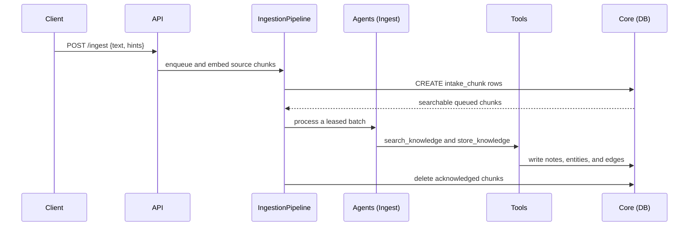

# Codemap

## Overview

Personal knowledge engine: a FastAPI REST API backed by an embedded SurrealDB graph database with five PydanticAI agent loops (ingest, recall, converse, dream-dedup, dream-connect), plus Go terminal and Flutter mobile clients. Knowledge flows in via ingest, is retrieved via recall, and is autonomously refined by background "dreaming" agents that deduplicate and discover missing connections.

```mermaid
graph LR
  Client --> API
  API --> Agents
  Agents --> Tools
  Tools --> Core
  Core --> SurrealDB[(SurrealDB)]
  Manual Test Tools --> API
  Manual Test Tools --> Client
```

### Key Flows

**Ingest → Knowledge Graph**

`POST /ingest` synchronously chunks, embeds, and stores raw intake evidence. It
returns `EnqueueResult {chunks_stored}`. The `IngestionPipeline` claims queued
chunks, invokes the ingest agent through `AgentIngestBatchRunner`, and deletes a
batch only after a clean graph write. Unprocessed chunks remain searchable until
that acknowledgement.



**Dream Cycle (Background)**

```mermaid
sequenceDiagram
  participant S as Agents (Scheduler)
  participant DD as Agents (Dream Dedup)
  participant DC as Agents (Dream Connect)
  participant T as Tools
  participant DB as Core (DB)
  S->>DD: run dedup cycle
  DD->>T: find_similar
  T->>DB: vector similarity search
  DB-->>T: candidate pairs
  T-->>DD: similar nodes
  DD->>T: merge_nodes + merge_edges
  T->>DB: merge + re-embed
  T-->>DD: merged
  DD-->>S: dedup complete
  S->>DC: run connect cycle
  DC->>T: find_unlinked_cooccurrences
  T->>DB: structural pattern search
  DB-->>T: unlinked pairs
  T-->>DC: candidates
  DC->>T: create_edges
  T->>DB: INSERT edges
  T-->>DC: connected
  DC-->>S: connect complete
```



## Modules

### Core

Foundation layer: configuration, shared types, database storage abstraction, model/embedding factory, and input validation.

**Responsibilities:** environment-based settings (`BRAIN_`, including queue lease,
retry, and shutdown limits), SurrealDB schema definition (graph tables,
`intake_chunk` and `intake_key`, BM25 analyzers, HNSW vector indexes), `Storage`
wrapping raw SurrealQL behind graph and queue operations (CRUD, lease/retry,
atomic staging, snapshots, cross-layer search candidates, and graph traversal),
`Embedder` injection, auto-embedding, query validation, typed models and
serialization helpers, provider factories, and record ID validation

**Dependencies:** none (leaf module — everything else depends on this)

**Files:**
- `src/second_brain/config.py`
- `src/second_brain/models.py`
- `src/second_brain/validation.py`
- `src/second_brain/providers.py`
- `src/second_brain/db.py`
- `src/second_brain/__init__.py`
- `src/second_brain/py.typed`
- `tests/test_config.py`
- `tests/test_db.py`
- `tests/test_models.py`
- `tests/test_providers.py`
- `tests/test_embedding.py`
- `tests/test_validation.py`
- `tests/test_intake_storage.py`
- `tests/test_intake_recall.py`

### Tools

Business logic layer consumed by agents. Composes `Storage` primitives from Core
without raw SurrealQL or `AsyncSurreal` imports. Tool sets cover ingest
(`store_knowledge` with reference resolution), recall (`search_memory` with
balanced cross-layer RRF and separate unprocessed evidence), and dream (semantic
search, merging, traversal, and co-occurrence discovery). All functions take
`storage: Storage` first.

**Responsibilities:** graph writes and edge deduplication, write-failure
reporting, cross-layer candidate fusion and graph-only enrichment, node/edge
merging, traversal, structural discovery, and citation evidence shaping

**Dependencies:** Core (Storage for all DB operations, validation helpers)

**Files:**
- `src/second_brain/tools/ingest_tools.py`
- `src/second_brain/tools/recall_tools.py`
- `src/second_brain/tools/dream_tools.py`
- `src/second_brain/tools/__init__.py`
- `tests/test_ingest_tools.py`
- `tests/test_store_knowledge.py`
- `tests/test_recall_tools.py`
- `tests/test_dream_tools.py`
- `tests/test_intake_recall.py`

### Agents

Five PydanticAI agent loops plus a background scheduler. User-facing **ingest**
stages raw text synchronously; the background `IngestionPipeline` invokes the
existing tool-driven agent to organize leased batches. **Recall** searches
organized and unprocessed evidence, and **converse** routes multi-turn requests
to those tools. Background **dream-dedup** and **dream-connect** refine the graph.
A fast-path Jev routing pass remains unchanged. The scheduler manages idle timing,
exponential delay, and convergence per idle period.

**Responsibilities:** LLM prompt definitions and system instructions, agent dependency injection (Deps dataclasses holding `storage: Storage`), tool registration per agent (ingest exposes single `store_knowledge` wrapper instead of separate create tools), conversation context accumulation, dream cycle orchestration (idle-triggered, activity-aware, with `DreamCycleState` managing exponential backoff delays and per-idle-period cycle cutoff), progress streaming via async queues

**Dependencies:** Core (Storage via Deps, models for context types), Tools (all three tool sets)

**Files:**
- `src/second_brain/agents/ingest.py`
- `src/second_brain/agents/ingestion_pipeline.py`
- `src/second_brain/agents/recall.py`
- `src/second_brain/agents/converse.py`
- `src/second_brain/agents/routing.py`
- `src/second_brain/agents/dream_dedup.py`
- `src/second_brain/agents/dream_connect.py`
- `src/second_brain/agents/__init__.py`
- `src/second_brain/scheduler.py`
- `tests/test_ingest_agent.py`
- `tests/test_ingestion_pipeline.py`
- `tests/test_recall_agent.py`
- `tests/test_converse_agent.py`
- `tests/test_converse_routing_http.py`
- `tests/test_routing.py`
- `tests/test_dream_dedup_agent.py`
- `tests/test_dream_connect_agent.py`
- `tests/test_scheduler.py`

### API

HTTP and MCP entry points. FastAPI app owns storage and pipeline lifespan,
request/response models, route handlers, and MCP tool wiring.

**Responsibilities:** REST endpoints (`/health`, synchronous `POST /ingest` with
`chunks_stored` and optional idempotency key, `/ingest/pipeline*` controls, async
202 `/dream` with dream-job polling, `/recall`, `/converse`, `/converse/stream`,
and `/graph/{id}`), separate graph and unprocessed recall context, SSE streaming,
startup/shutdown injection, validation, response shaping, and MCP tools for
staging, recall, and graph lookup

**Dependencies:** Core (config, Storage + Embedder, models, providers, validation), Agents (all five agents + scheduler)

**Files:**
- `src/second_brain/app.py`
- `src/second_brain/mcp.py`
- `tests/test_app.py`
- `tests/test_mcp.py`
- `tests/test_intake_http.py`
- `tests/test_intake_mcp.py`
- `tests/test_intake_converse.py`
- `tests/test_intake_recall_http.py`
- `tests/conftest.py`
- `tests/__init__.py`

### Client

Client applications: a Go terminal client with a Cobra CLI and Bubble Tea TUI, plus an Android-first Flutter mobile app. The Go client supports one-shot ingest, recall, and graph commands, and interactive multi-turn conversation. The mobile client supports Capture and one-shot Ask through the existing REST API, with local server settings and failed Capture drafts.

**Responsibilities:** CLI entry points and flag parsing, synchronous ingest acknowledgement, HTTP client for server endpoints, separate unprocessed recall/context wire types, SSE stream parsing for converse, interactive TUI with split-pane layout, chat message rendering with viewport scrolling, graph-only node/edge display with selection and detail view, @-mention autocomplete against graph nodes, slash commands (/exit, /clear, /graph), mobile setup and settings, typed REST gateway and response models, idempotent Capture retries with persisted drafts, one-shot recall results with grouped evidence

**Dependencies:** API (HTTP endpoints — runtime dependency, not code import)

**Files:**
- `client/cmd/brain/**`
- `client/internal/api/**`
- `client/internal/tui/**`
- `client/internal/types/**`
- `client/e2e/**`
- `client/go.mod`
- `client/go.sum`
- `client/.golangci.yml`
- `client/.gitignore`
- `client/mobile/**`

### Manual Test Tools

Permanent home for reusable manual-test drivers and documented operator journeys.

**Responsibilities:** manual smoke-test plans, reusable test tools and drivers, recorded journey results, harness limitations

**Dependencies:** API and Client (manual journeys exercise their public interfaces); no code imports

**Files:**
- `tools/manual-test/**`
- `docs/manual-tests/**`
